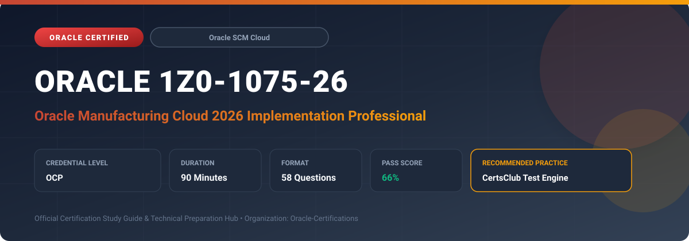

  

# Oracle 1Z0-1075-26: Oracle Manufacturing Cloud 2026 Implementation Professional

---

## 1. Exam Overview & Candidate Profile

The **Oracle 1Z0-1075-26: Oracle Manufacturing Cloud 2026 Implementation Professional** examination is engineered for enterprise architects, solution specialists, functional consultants, and implementation professionals seeking formal industry recognition of their proficiency in Oracle technologies.

The Oracle Manufacturing Cloud 2026 Implementation Professional (1Z0-1075-26) certification validates the ability to configure and deploy Oracle Manufacturing Cloud across complex discrete and process manufacturing environments. It covers work center hierarchies, work order execution, dispatch consoles, production exception handling, and cost integration.

### Target Audience & Prerequisites
- **Target Roles**: Implementation Specialists, Cloud Architects, Technical Leads, Enterprise Functional Consultants, and Systems Engineers.
- **Recommended Experience**: 1–2 years of practical, hands-on experience designing, implementing, and maintaining corresponding Oracle Cloud solutions.
- **Credential Earned**: Oracle Certified Professional (OCP).

---

## 2. Key Exam Specifications

| Specification | Details |
| :--- | :--- |
| **Exam Code** | **Oracle 1Z0-1075-26** |
| **Official Title** | Oracle Manufacturing Cloud 2026 Implementation Professional |
| **Certification Track** | Oracle Supply Chain Management Cloud |
| **Exam Duration** | 90 Minutes |
| **Number of Questions** | 58 Questions |
| **Passing Score** | 66% |
| **Question Format** | Multiple Choice (Single/Multiple Answer), Scenario-Based Questions |
| **Delivery Provider** | Oracle University / Pearson VUE (Online Proctored or Test Center) |
| **Recommended Practice Engine** | [CertsClub Oracle Practice Tests](https://www.certsclub.com/oracle/1z0-1075-26-dumps.html) |

---

## 3. Official Blueprint & Exam Domain Breakdown

The examination assesses candidate competencies across core functional domains weighted as follows:

| Domain Area | Weighting |
| :--- | :--- |
| **Manufacturing Plant Setup & Work Center Configuration** | `20%` |
| **Work Definitions, Operations, & Item Structures** | `25%` |
| **Work Order Management & Production Scheduling** | `25%` |
| **Shop Floor Execution, Dispatch Console & Material Reporting** | `15%` |
| **Manufacturing Exceptions, Quality, & Cost Integration** | `15%` |

---

## 4. Deep Dive into Complex & Challenging Technical Topics

To secure a passing score on the 1Z0-1075-26 exam, candidates must master the following advanced concepts:

- Advanced work center setup, equipment shifts, labor resources, and efficiency factors.
- Configuring Outside Processing (OSP) operations, purchasing requisitions, shipping to suppliers, and supplier return receipts.
- Handling production exceptions, scrap and reject recording, rework work orders, and co-products/by-products.
- Synchronizing production transactions with Cost Accounting and Inventory Management.

---

## 5. Scenario-Based Demo & Practice Questions

### Question 1
In an Outside Processing (OSP) workflow within Oracle Manufacturing Cloud, what event triggers the creation of a Purchase Order line in Oracle Procurement Cloud?

A) Creating the Work Definition
B) Releasing the Work Order containing the OSP operation
C) Completing the prior in-house operation
D) Receiving the finished part from the vendor

- **Correct Answer**: `B) Releasing the Work Order containing the OSP operation`  
- **Technical Explanation**: When a work order with an outside processing operation is released, the system triggers the automatic generation of purchase requisitions/orders in Oracle Procurement Cloud for the supplier service.

---

### Question 2
A production supervisor observes an equipment breakdown during active operations. How can the supervisor record this incident in the Dispatch Console to inform planning and maintenance?

A) Cancel the Work Order
B) Log a Production Exception linked to the Work Center and Resource
C) Change the Item Primary UOM
D) Adjust the Work Definition revision date

- **Correct Answer**: `B) Log a Production Exception linked to the Work Center and Resource`  
- **Technical Explanation**: The Dispatch Console enables operators and supervisors to log Production Exceptions for resources and work centers, capturing downtime causes and broadcasting operational alerts.

---

## 6. Recommended Preparation Strategy & Practice Testing Engine

Achieving certification in **Oracle 1Z0-1075-26** requires balanced theoretical study and scenario-based simulation practice:

1. **Review Oracle Documentation**: Master architecture guides, implementation workbooks, and administration manuals on the Oracle Help Center.
2. **Hands-on Lab Practice**: Execute real-world configuration, policy setup, and troubleshooting tasks in your cloud tenancy or test instance.
3. **Simulated Exam Drills**: Practice answering timed, scenario-based multiple-choice questions to familiarize yourself with the question formats, traps, and timing constraints.

### Practice With CertsClub
For realistic practice questions, updated dumps, and mock testing environments:
- **Resource**: [CertsClub Oracle Practice Test Engine](https://www.certsclub.com/oracle/1z0-1075-26-dumps.html)
- **Special Discount**: Use coupon code **`club20`** during checkout for an instant **20% discount** on all practice exam bundles and testing engines.

---

## 7. Official Documentation & References

- [Oracle University Certification Registry](https://education.oracle.com/)
- [Oracle Help Center Documentation Portal](https://docs.oracle.com/)
- [Oracle Cloud Infrastructure & Applications Guides](https://docs.oracle.com/en/cloud/)
- [CertsClub Oracle Certification Exam Practice](https://www.certsclub.com/oracle/1z0-1075-26-dumps.html)

---

## 8. SEO & Discovery Keywords

`oracle 1z0-1075-26, oracle 1z0-1075-26 exam, oracle 1z0-1075-26 dumps, 1Z0-1075-26 practice questions, 1Z0-1075-26 study guide, oracle 1z0-1075-26 syllabus, oracle manufacturing cloud 2026 implementation professional, certsclub 1z0-1075-26`
